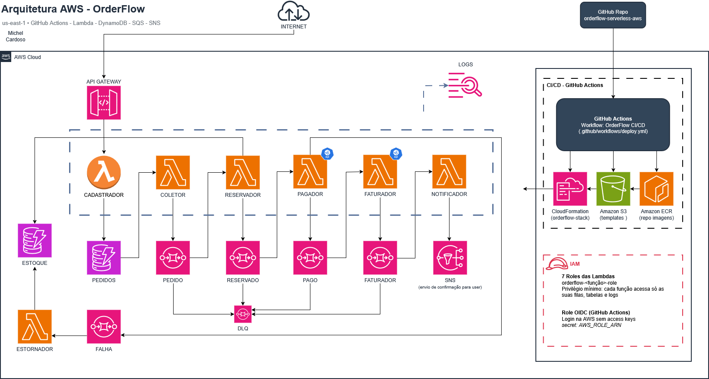
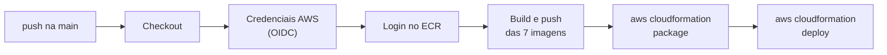
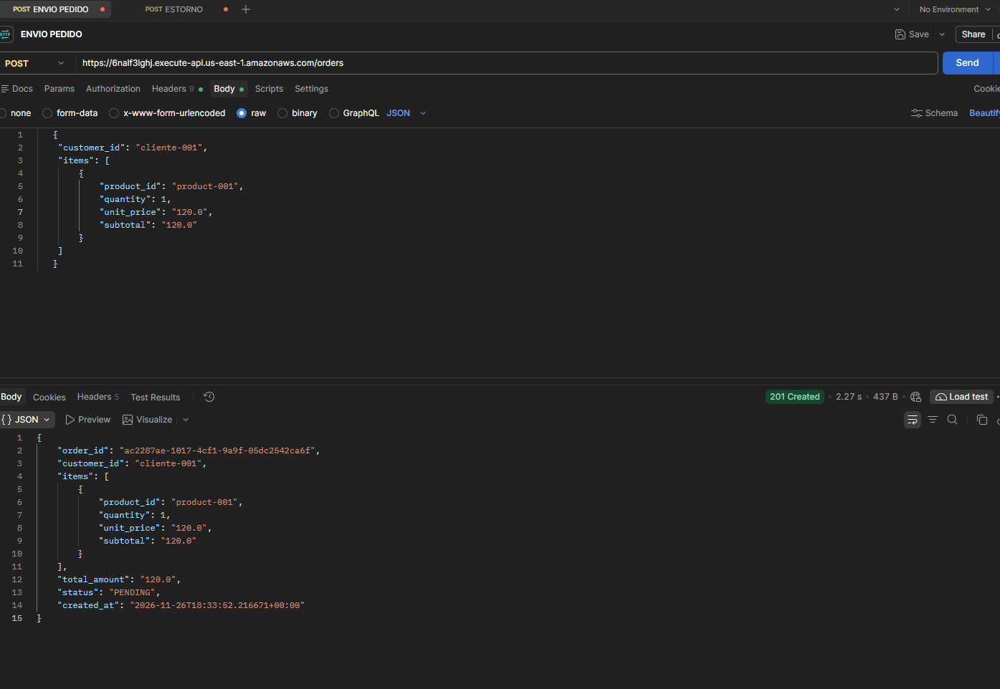
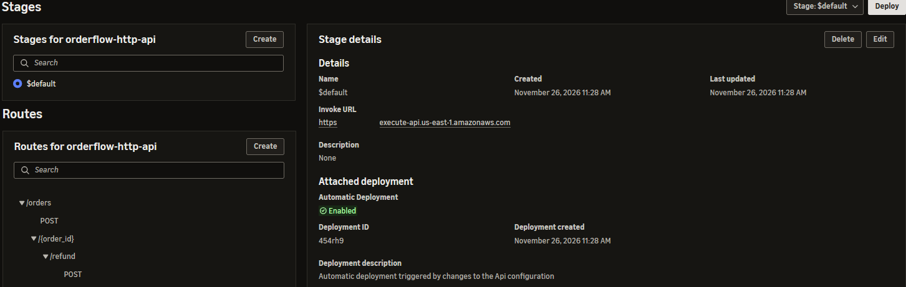
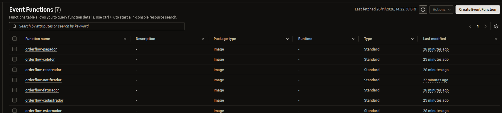
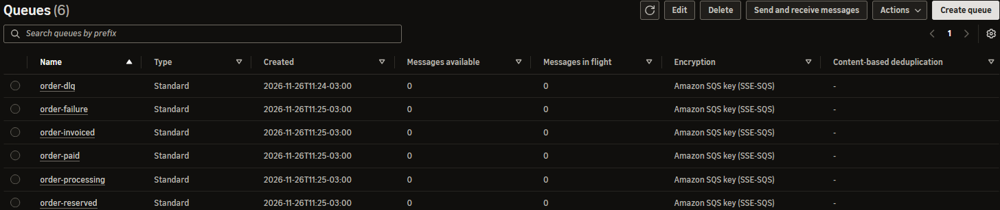
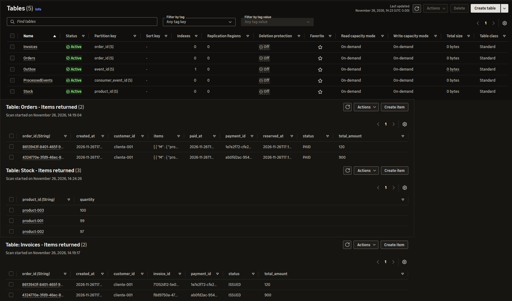
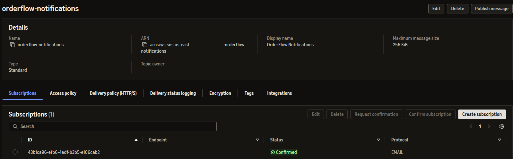
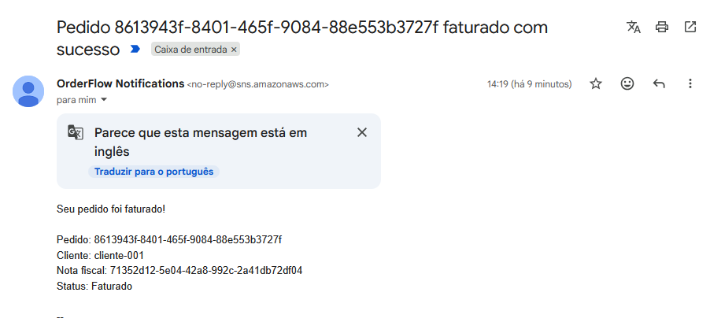
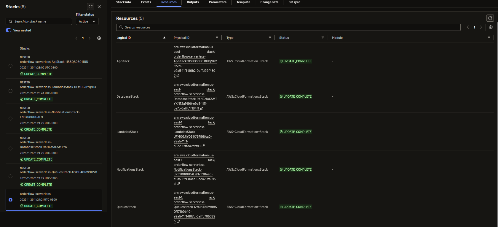

# 🛒 OrderFlow Microservices

## 📖 Sobre o projeto

API de processamento de pedidos construída em **Python** com serviços **serverless da AWS**, seguindo uma arquitetura de **microsserviços orientada a eventos**, com infraestrutura gerenciada como código (**CloudFormation**) e pipeline de **CI/CD automatizado com GitHub Actions**.


---

## 📋 Visão geral

| Item | Detalhe |
|---|---|
| **Aplicação** | Processamento de pedidos: cadastro, reserva, pagamento, faturamento, notificação e estorno |
| **Linguagem** | Python (Boto3 / Botocore) |
| **Entrada** | Amazon API Gateway (HTTP API) |
| **Processamento** | 7 funções AWS Lambda, empacotadas como **imagens de container** (ECR) |
| **Comunicação entre serviços** | 6 filas Amazon SQS (uma delas é a **DLQ**) |
| **Persistência** | 5 tabelas Amazon DynamoDB (modo *on-demand*) |
| **Notificação** | Amazon SNS (e-mail de confirmação de faturamento) |
| **Observabilidade** | Amazon CloudWatch Logs (retenção de 14 dias) |
| **IaC** | AWS CloudFormation com *nested stacks* |
| **CI/CD** | GitHub Actions, autenticado na AWS via **OIDC** (sem access keys) |
| **Ambiente local** | Docker Compose com ElasticMQ (SQS) e DynamoDB Local |
| **Região** | `us-east-1` (N. Virginia) |

---

## 🏗 Arquitetura



Cada etapa do pedido é um **microsserviço independente** (uma Lambda), que consome uma fila, executa sua responsabilidade e publica o resultado na fila seguinte. Nenhuma Lambda chama outra diretamente: todo o acoplamento acontece por **eventos**. O diagrama em draw.io está em [`docs/images/arq-orderflow-aws.drawio`](docs/images/arq-orderflow-aws.drawio) e pode ser aberto em [app.diagrams.net](https://app.diagrams.net).

### 🧩 Funções Lambda

| Lambda | Gatilho | Responsabilidade | Publica em |
|---|---|---|---|
| `orderflow-cadastrador` | API Gateway (`POST /orders` e `POST /orders/{order_id}/refund`) | Recebe e grava o pedido (status `PENDING`) e o evento no Outbox, na mesma transação | Outbox (DynamoDB) |
| `orderflow-coletor` | DynamoDB Streams da tabela Outbox | Captura novos eventos `ORDER_CREATED` e os encaminha para a fila | `order-processing` |
| `orderflow-reservador` | Fila `order-processing` | Reserva o pedido e registra o momento da reserva | `order-reserved` |
| `orderflow-pagador` | Fila `order-reserved` | Processa o pagamento, atualiza o pedido para `PAID` e baixa o estoque | `order-paid` ou `order-failure` |
| `orderflow-faturador` | Fila `order-paid` | Emite a nota fiscal (tabela Invoices) | `order-invoiced` |
| `orderflow-notificador` | Fila `order-invoiced` | Publica a confirmação de faturamento no tópico SNS | SNS `orderflow-notifications` |
| `orderflow-estornador` | Fila `order-failure` | Compensação: devolve o estoque quando o pedido falha ou é estornado | Stock (DynamoDB) |

### 🗄 Tabelas DynamoDB

| Tabela | Chave de partição | Função |
|---|---|---|
| `Orders` | `order_id` | Pedidos e seus estados (`PENDING`, `PAID`...) |
| `Stock` | `product_id` | Quantidade disponível por produto |
| `Invoices` | `order_id` | Notas fiscais emitidas |
| `Outbox` | `event_id` | Eventos a publicar (com *stream* e índice `StatusCreatedAtIndex`) |
| `ProcessedEvents` | `consumer_event_id` | Controle de idempotência dos consumidores |

### 📨 Filas SQS

| Fila | Papel |
|---|---|
| `order-processing` | Pedido criado, aguardando reserva |
| `order-reserved` | Pedido reservado, aguardando pagamento |
| `order-paid` | Pedido pago, aguardando faturamento |
| `order-invoiced` | Pedido faturado, aguardando notificação |
| `order-failure` | Falhas de pagamento, aguardando estorno |
| `order-dlq` | **Dead Letter Queue**: recebe mensagens que falharam 3 vezes |

---

## 🔄 Fluxo de um pedido

1. O cliente envia `POST /orders` para o **API Gateway**, que aciona a Lambda **cadastrador**.
2. O cadastrador grava o pedido e o evento `ORDER_CREATED` no Outbox **na mesma transação**. A API responde `201 Created` com o pedido em `PENDING`.
3. O **DynamoDB Streams** do Outbox dispara o **coletor**, que publica o evento na fila `order-processing`.
4. O **reservador** consome a fila e reserva o pedido, publicando em `order-reserved`.
5. O **pagador** processa o pagamento. Em caso de sucesso, marca o pedido como `PAID`, baixa o estoque e publica em `order-paid`. Em caso de falha, publica em `order-failure`.
6. O **faturador** emite a nota fiscal e publica em `order-invoiced`.
7. O **notificador** publica no **SNS**, que envia o e-mail de confirmação ao cliente.
8. Se algo falhar, o **estornador** consome `order-failure` e devolve o estoque (**compensação**).

---

## 🧠 Padrões e decisões de projeto

- **Arquitetura orientada a eventos:** serviços desacoplados, comunicando-se por filas SQS.
- **Transactional Outbox:** o pedido e o evento são gravados juntos (`TransactWriteItems`), e um *stream* do DynamoDB publica o evento. Isso evita o problema de gravar no banco e falhar ao publicar na fila.
- **Idempotência:** a tabela `ProcessedEvents` (`consumer_event_id`) garante que um evento entregue mais de uma vez não seja processado duas vezes.
- **Dead Letter Queue:** todas as filas redirecionam para `order-dlq` após **3 tentativas** (`maxReceiveCount: 3`), com retenção de 14 dias na DLQ.
- **Falhas parciais em lote:** os *event source mappings* usam `ReportBatchItemFailures` (lote de 10), de modo que só as mensagens com erro voltam para a fila.
- **Compensação (estorno):** falhas no meio do fluxo são revertidas pelo estornador, devolvendo o estoque.
- **Privilégio mínimo:** cada Lambda tem sua própria **IAM Role**, limitada às filas, tabelas e logs de que precisa.
- **Long polling e visibilidade:** filas com `ReceiveMessageWaitTimeSeconds: 20` e `VisibilityTimeout: 60`.
- **Criptografia:** filas com SSE-SQS.
- **Sem segredos no repositório:** o pipeline usa OIDC e *secrets* do GitHub.

---

## 🛠 Ferramentas e tecnologias

| Categoria | Ferramentas |
|---|---|
| **Desenvolvimento** | Python, Boto3, Botocore, Pytest |
| **Ambiente local** | ElasticMQ (filas SQS locais), DynamoDB Local (banco local) |
| **Contêineres** | Docker e Docker Compose |
| **Testes de API** | Postman |
| **AWS** | API Gateway, Lambda, SQS, DynamoDB, SNS, CloudWatch Logs, ECR, S3 |
| **IaC** | CloudFormation (*nested stacks*) |
| **CI/CD** | GitHub Actions |

---

## 📁 Estrutura do projeto

```text
orderflow-serverless-aws/
├── .github/
│   └── workflows/
│       └── deploy.yml              # Pipeline CI/CD (build, package e deploy)
├── docker/
│   ├── Dockerfile.lambda           # Imagem base das Lambdas (handler via build-arg)
│   └── lambda-entrypoint.sh
├── docs/
│   └── images/                     # Diagrama de arquitetura e evidências
├── infrastructure/
│   ├── cloudformation/
│   │   ├── main.yaml               # Stack principal (orquestra as nested stacks)
│   │   └── templates/
│   │       ├── api.yaml            # API Gateway HTTP API
│   │       ├── database.yaml       # Tabelas DynamoDB
│   │       ├── lambdas.yaml        # Lambdas, IAM Roles, mappings e Log Groups
│   │       ├── notifications.yaml  # Tópico e assinatura SNS
│   │       └── queues.yaml         # Filas SQS e DLQ
│   └── local/
│       └── elasticmq.conf          # Configuração do SQS local
├── scripts/                        # Scripts de apoio ao ambiente local
│   ├── create_tables.py            # Cria as tabelas no DynamoDB Local
│   ├── create_queues.py            # Cria as filas no ElasticMQ
│   ├── run_collector.py / publish_outbox.py
│   ├── consume_orders.py / consume_payments.py / consume_invoices.py
│   ├── consume_notifications.py / consume_refunds.py
│   └── request_refund.py / requeue_invoiced_events.py
├── src/
│   ├── functions/                  # Um diretório por microsserviço
│   │   ├── cadastrador/            # handler.py + service.py
│   │   ├── coletor/
│   │   ├── reservador/
│   │   ├── pagador/
│   │   ├── faturador/
│   │   ├── notificador/
│   │   └── estornador/
│   └── shared/                     # Código compartilhado
│       ├── config/settings.py      # Configurações e variáveis de ambiente
│       ├── database/dynamodb.py    # Acesso ao DynamoDB
│       ├── events/                 # sqs.py, sns.py e idempotency.py
│       └── utils/
├── tests/
│   ├── unit/                       # Testes de serviço e handlers (isolados)
│   └── integration/                # Testes contra DynamoDB/SQS locais
├── docker-compose.yml              # ElasticMQ + DynamoDB Local
├── requirements.txt                # Dependências de desenvolvimento
├── requirements-lambda.txt         # Dependências empacotadas nas Lambdas
├── .env.example                    # Modelo de variáveis de ambiente
└── README.md
```

> Cada microsserviço segue o mesmo padrão: `handler.py` (entrada da Lambda, fino) e `service.py` (regra de negócio), o que facilita os testes unitários.

---

## 🧱 Infraestrutura como código (CloudFormation)

Toda a infraestrutura é descrita em YAML e dividida em **nested stacks**, orquestradas pelo `main.yaml`:

| Stack | Template | Recursos |
|---|---|---|
| `DatabaseStack` | `templates/database.yaml` | 5 tabelas DynamoDB (on-demand) e *stream* do Outbox |
| `QueuesStack` | `templates/queues.yaml` | 5 filas de negócio + 1 DLQ |
| `NotificationsStack` | `templates/notifications.yaml` | Tópico SNS e assinatura por e-mail |
| `LambdasStack` | `templates/lambdas.yaml` | 7 Lambdas (imagem), IAM Roles, *event source mappings* e Log Groups |
| `ApiStack` | `templates/api.yaml` | HTTP API, rotas, integração com o cadastrador e *stage* `$default` com auto deploy |

**Parâmetros da stack principal**

| Parâmetro | Descrição |
|---|---|
| `NotificationEmail` | E-mail que receberá as confirmações de faturamento |
| `ImageTag` | Tag das imagens Docker das Lambdas (o pipeline usa o SHA do commit) |

**Saída:** `ApiEndpoint`, o endpoint público da API.

**Rotas expostas**

| Método | Rota | Descrição |
|---|---|---|
| `POST` | `/orders` | Cria um pedido |
| `POST` | `/orders/{order_id}/refund` | Solicita o estorno de um pedido |

---

## ⚙️ CI/CD com GitHub Actions

O workflow [`deploy.yml`](.github/workflows/deploy.yml) (**OrderFlow CI/CD**) roda a cada `push` na branch `main` e também pode ser disparado manualmente (`workflow_dispatch`).



| Etapa | O que faz |
|---|---|
| **Configure AWS credentials** | Assume uma IAM Role via **OIDC** (sem access keys) |
| **Login to Amazon ECR** | Autentica no repositório `orderflow-lambda` |
| **Build and push Lambda images** | Constrói uma imagem por função (`linux/amd64`), com tag `<sha-do-commit>-<função>` |
| **Package CloudFormation templates** | Envia as *nested stacks* ao bucket S3 e gera o `packaged.yaml` |
| **Deploy CloudFormation stack** | Cria ou atualiza a stack usando uma *service role* do CloudFormation |

### 🔐 Secrets necessários (Settings → Secrets and variables → Actions)

| Secret | Descrição |
|---|---|
| `AWS_ROLE_ARN` | Role assumida pelo GitHub Actions via OIDC |
| `AWS_ACCOUNT_ID` | ID da conta AWS (monta a URI do ECR) |
| `TEMPLATE_BUCKET` | Bucket S3 que armazena os templates empacotados |
| `CLOUDFORMATION_ROLE_ARN` | Role que o CloudFormation usa para criar os recursos |
| `NOTIFICATION_EMAIL` | E-mail que receberá as notificações do SNS |

### ✅ Pré-requisitos para o primeiro deploy

Estes recursos **não são criados pelo pipeline** e precisam existir antes:

1. Repositório **ECR** chamado `orderflow-lambda`.
2. Bucket **S3** para os templates (valor do secret `TEMPLATE_BUCKET`).
3. **Identity Provider OIDC** do GitHub na conta e a role referenciada em `AWS_ROLE_ARN`.
4. **Service role** do CloudFormation (`CLOUDFORMATION_ROLE_ARN`) com permissão para criar os recursos da stack.
5. Os 5 *secrets* cadastrados no repositório.

---

## 💻 Desenvolvimento local

O ambiente local substitui os serviços da AWS por **ElasticMQ** (SQS) e **DynamoDB Local**, ambos via Docker Compose.

**Requisitos:** Python 3.13, Docker e Docker Compose.

```bash
# 1. Clonar o repositório
git clone https://github.com/myxenje/orderflow-serverless-aws.git
cd orderflow-serverless-aws

# 2. Criar o ambiente virtual e instalar as dependências
python -m venv .venv
source .venv/bin/activate        # Windows: .venv\Scripts\activate
pip install -r requirements.txt

# 3. Configurar as variáveis de ambiente
cp .env.example .env             # Windows: copy .env.example .env

# 4. Subir os serviços locais
docker compose up -d

# 5. Criar tabelas e filas locais
python scripts/create_tables.py
python scripts/create_queues.py
```

Com o ambiente de pé, os scripts em `scripts/` permitem simular cada etapa do fluxo (por exemplo, `run_collector.py`, `consume_orders.py`, `consume_payments.py`, `consume_invoices.py`, `consume_notifications.py` e `consume_refunds.py`).

**Variáveis de ambiente usadas pelas Lambdas na AWS** (definidas no `lambdas.yaml`):

| Variável | Usada por |
|---|---|
| `SQS_ORDER_CREATED_QUEUE_URL` | coletor |
| `SQS_ORDER_RESERVED_QUEUE_URL` | reservador |
| `SQS_ORDER_PAID_QUEUE_URL` | pagador |
| `SQS_ORDER_FAILURE_QUEUE_URL` | pagador |
| `SQS_ORDER_INVOICED_QUEUE_URL` | faturador |
| `SNS_TOPIC_ARN` | notificador |

---

## 🧪 Testes automatizados

A suíte usa **Pytest** e está dividida em duas camadas:

- **`tests/unit`**: testa a regra de negócio (`service.py`) e os handlers de forma isolada.
- **`tests/integration`**: testa os handlers, a idempotência, o Outbox e a conexão com o DynamoDB, usando o ambiente local (Docker Compose).

```bash
# Todos os testes (com o docker compose rodando)
pytest

# Somente os unitários
pytest tests/unit

# Com cobertura
pytest --cov=src
```

---

## 🚀 Testando a API na AWS

Depois do deploy, obtenha o endpoint da API:

```bash
aws cloudformation describe-stacks \
  --stack-name orderflow-stack \
  --region us-east-1 \
  --query "Stacks[0].Outputs[?OutputKey=='ApiEndpoint'].OutputValue" \
  --output text
```

> ⚠️ **Estoque:** as tabelas são criadas vazias. Antes do primeiro pedido, cadastre produtos na tabela `Stock`:
>
> ```bash
> for p in product-001 product-002 product-003; do
>   aws dynamodb put-item --region us-east-1 --table-name Stock \
>     --item "{\"product_id\":{\"S\":\"$p\"},\"quantity\":{\"N\":\"100\"}}"
> done
> ```

> ⚠️ **E-mail:** a assinatura do SNS precisa ser **confirmada** no link enviado pela AWS (*AWS Notification - Subscription Confirmation*). Sem isso, nenhum e-mail de pedido é entregue.

### Criar um pedido

```bash
curl -X POST "<API_ENDPOINT>/orders" \
  -H "Content-Type: application/json" \
  -d '{
    "customer_id": "cliente-001",
    "items": [
      {
        "product_id": "product-001",
        "quantity": 1,
        "unit_price": "120.0",
        "subtotal": "120.0"
      }
    ]
  }'
```

**Resposta esperada: `201 Created`**

```json
{
  "order_id": "ac2287ae-1017-4cf1-9a9f-05dc2542ca6f",
  "customer_id": "cliente-001",
  "items": [
    {
      "product_id": "product-001",
      "quantity": 1,
      "unit_price": "120.0",
      "subtotal": "120.0"
    }
  ],
  "total_amount": "120.0",
  "status": "PENDING",
  "created_at": "2026-11-26T18:33:52.216671+00:00"
}
```

O pedido nasce como `PENDING` e evolui de forma **assíncrona** pelas filas. Em poucos segundos ele chega a `PAID`, a nota fiscal é emitida e o e-mail de confirmação é enviado.

### Solicitar estorno

```bash
curl -X POST "<API_ENDPOINT>/orders/<order_id>/refund"
```

### Acompanhar a execução

- **DynamoDB:** consulte `Orders` e `Invoices` para ver o status do pedido e a nota fiscal.
- **SQS:** `order-dlq` deve permanecer com **0 mensagens**; caso contrário, houve falha no processamento.
- **CloudWatch Logs:** cada Lambda tem seu grupo `/aws/lambda/orderflow-<função>`.

```bash
aws logs tail /aws/lambda/orderflow-pagador --follow --region us-east-1
```

---

## 📸 Evidências do projeto em execução

### Requisição no Postman
`POST /orders` retornando `201 Created`, com o pedido em `PENDING`.



### API Gateway
HTTP API `orderflow-http-api` com as rotas `POST /orders` e `POST /orders/{order_id}/refund`.



### Funções Lambda
As 7 funções do fluxo, todas empacotadas como imagem de container.



### Filas SQS
As 5 filas de negócio e a DLQ, criptografadas com SSE-SQS e sem mensagens pendentes após o processamento.



### Tabelas DynamoDB
Pedidos em `PAID`, notas fiscais com status `ISSUED` e o estoque atualizado após as vendas.



### Tópico SNS
Tópico `orderflow-notifications` com a assinatura de e-mail confirmada.



### E-mail de confirmação
Notificação de faturamento recebida pelo cliente, com o número do pedido, o cliente e a nota fiscal.



### CloudFormation
Stack principal e as *nested stacks* implantadas.



---

## 🧹 Remover e recriar o ambiente

Para evitar custos em ambiente de teste, basta **excluir a stack**. As nested stacks, Lambdas, filas, tabelas, tópico, API e Log Groups são removidos juntos.

```bash
aws cloudformation delete-stack --stack-name orderflow-stack --region us-east-1
aws cloudformation wait stack-delete-complete --stack-name orderflow-stack --region us-east-1
```

> A exclusão também pode ser feita pelo console: **CloudFormation → Stacks → Delete**.

**Não fazem parte da stack** e continuam existindo (e podem gerar pequenos custos): o repositório **ECR** com as imagens, o bucket **S3** de templates e os recursos de OIDC/IAM. Se quiser zerar tudo, remova-os manualmente.

### Recriando

1. No GitHub, abra **Actions → OrderFlow CI/CD**.
2. Escolha a última execução e clique em **Re-run all jobs**, ou use **Run workflow** (disparo manual), ou faça um novo `push` na `main`.
3. Aguarde o deploy terminar (a stack volta a `CREATE_COMPLETE`).

Depois de recriar, lembre-se de que **tudo foi apagado junto**:

- [ ] Cadastrar novamente os produtos na tabela `Stock`.
- [ ] Confirmar a nova assinatura do SNS no e-mail recebido.
- [ ] Anotar o novo endpoint da API (a URL muda a cada recriação).

> 💡 O *re-run* reaproveita o mesmo commit. Se você alterou o código depois, faça um novo `push` (ou use **Run workflow**) para implantar a versão mais recente.

---

## 🔭 Próximos passos

- [ ] Substituir o SNS por **Amazon SES** para e-mails transacionais personalizados.
- [ ] Autenticação na API (Cognito ou authorizer JWT).


---

## 👨‍💻 Autor

Michel Cardoso

Projeto desenvolvido para fins de estudo e prática de tecnologias voltadas para desenvolvimento back-end, microserviços, infraestrutura, aws cloud e containerização.